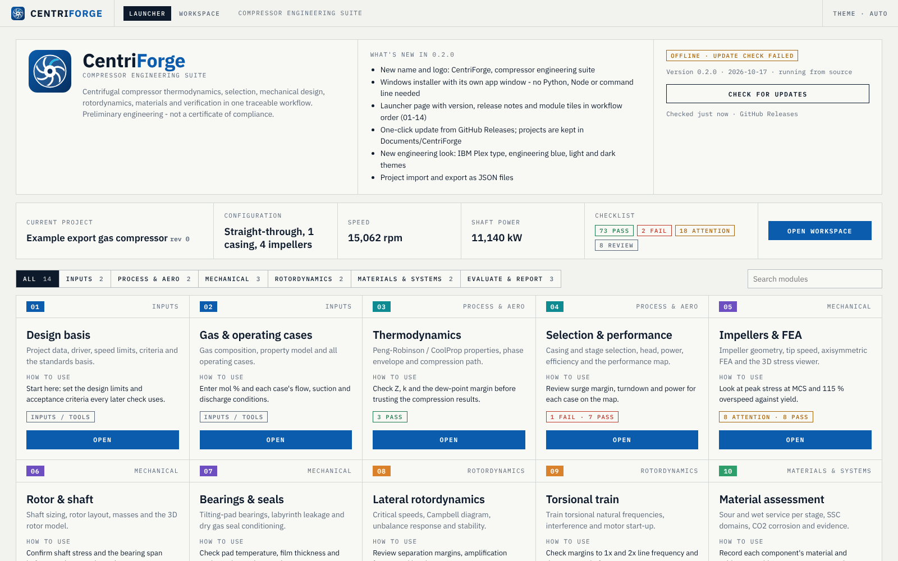
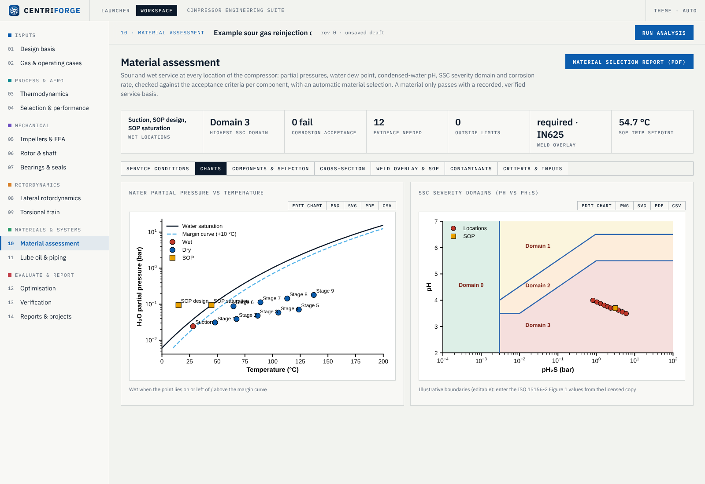
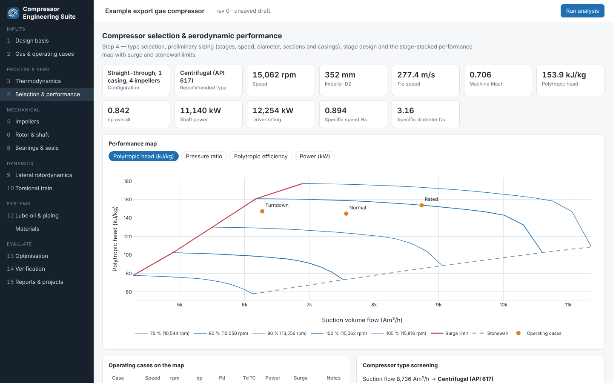
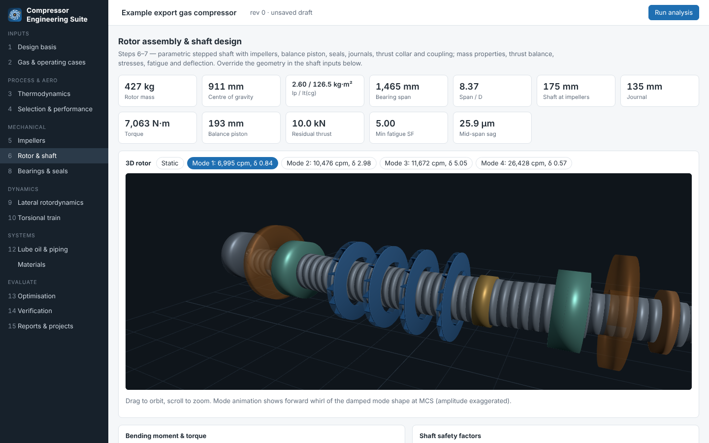
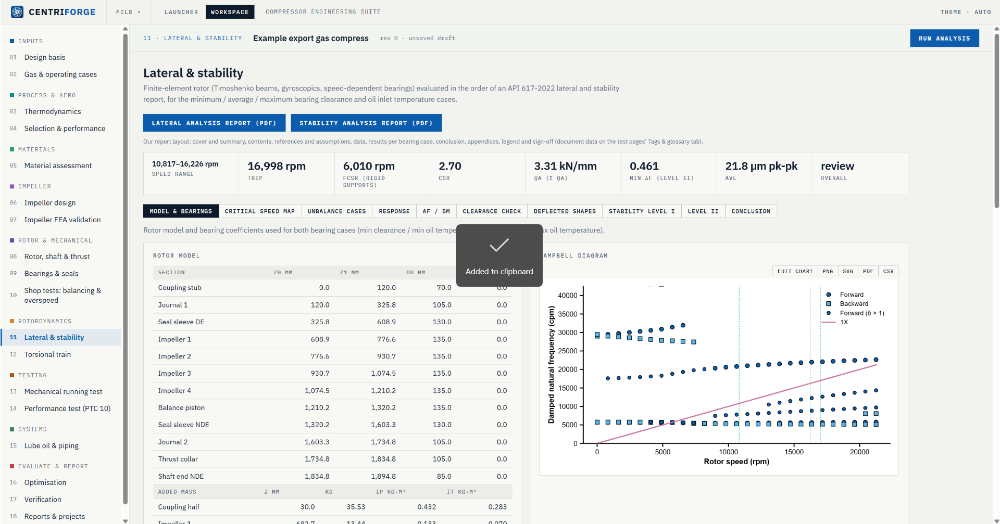
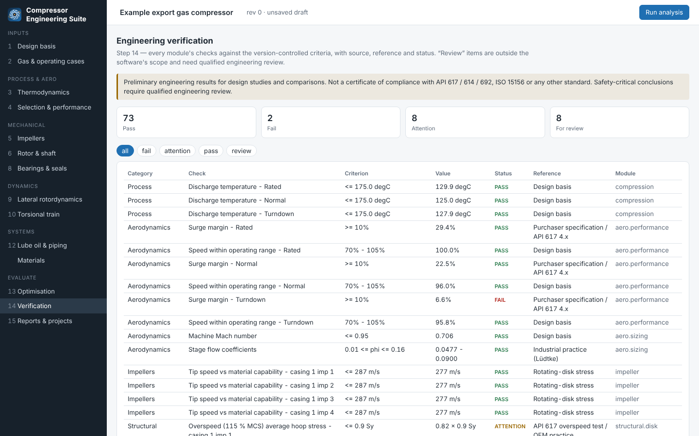
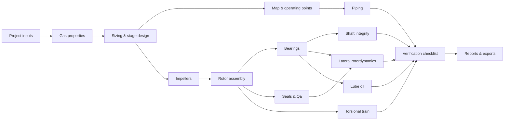

<p align="center">
  
</p>

<p align="center">
  <a href="https://github.com/Edgar-Mendonca/Compressor-Engineering-Suite/releases/latest"></a>
  <a href="https://github.com/Edgar-Mendonca/Compressor-Engineering-Suite/actions/workflows/ci.yml"></a>
  
  
  
</p>

**CentriForge** is an open-source compressor engineering suite, a Windows desktop app (or browser app) for the
preliminary design, selection, simulation and technical evaluation of industrial centrifugal compressors. Every module works on one shared
engineering model, so a change to the gas, an operating case, the shaft or a bearing propagates through
thermodynamics, aerodynamics, mechanics, rotordynamics and verification in a single run.

```
Process → Thermodynamics → Selection & aerodynamics → Impellers → Rotor & shaft → Bearings & seals
        → Lateral & torsional rotordynamics → Structural → Auxiliaries → Optimisation → Verification → Reports
```

> [!IMPORTANT]
> Results support preliminary engineering, design studies and comparisons. The suite does **not** certify
> compliance with API 617, API 614, API 692, ISO 15156 or any other standard. Acceptance criteria are configurable
> and must be checked against the edition that applies to your job. Detailed design and safety-critical
> conclusions require review by a qualified engineer.

<p align="center">
  
  
  
  
  
  
</p>

## Contents

- [Feature status](#feature-status)
- [Quick start](#quick-start)
- [Modules and workflows](#modules-and-workflows)
- [Reports](#reports)
- [Example result](#example-result)
- [How it works](#how-it-works)
- [Validation](#validation)
- [Project layout](#project-layout)
- [Documentation](#documentation)
- [Release plan](#release-plan)
- [Contributing](#contributing)

## Feature status

✅ **Available now** — implemented and covered by tests · 🚧 **Yet to build** — known gaps in the current scope ·
💡 **Possible extensions** — ideas that fit the architecture and would add value

| Area | ✅ Available now | 🚧 Yet to build | 💡 Possible extensions |
|---|---|---|---|
| **Thermodynamics** | 19-component mixtures (plus R134a); Peng–Robinson (built in) or CoolProp; Z, ρ, h, s, cp/cv, sound speed, viscosity; dew/bubble points, phase envelope, water dew point; property charts | Thermal conductivity; direct GERG-2008; hydrate formation | Cantera transport properties; C7+ pseudo-components; REFPROP adapter |
| **Compression** | Real-gas polytropic path, isentropic, Schultz and Sandberg-Colby (ASME PTC 10); head, power, efficiency; efficiency from test temperatures; flow-unit conversions | Side-stream sections in the test evaluation | ccp (Petrobras) adapter |
| **Selection & aerodynamics** | Type screening; stages, sections, intercooling, casings; speed and D2; φ/ψ, Ns/Ds; stage-by-stage design; stage-stacked map with surge/stonewall; operating points; surge margin | Mean-line stage model; Mach effects on curves; inlet guide vanes | TurboFlow / h2iCompressor mean-line engine; vendor stage-curve import |
| **Impellers & FEA** | Geometry, velocity triangles, slip, thrust; axisymmetric FEA validated against CalculiX; **3D cyclic-sector FEA** (centrifugal, pressure, thermal, shrink fit; elastic-plastic 115 % overspeed; modes / SAFE; Goodman and LCF fatigue); 3D viewer with element mesh, colour bands, MAX / MIN and report pictures | Blade flutter / aero-elastic forcing | Parametric impeller CAD; CFD-ready blade export |
| **Rotor & shaft** | Stepped shaft or user geometry; balance drum from thrust; collar, couplings, sleeves; mass / CG / inertia; bending and torque; Kt, Marin, Goodman fatigue; sag and stiffness | Shrink-fit and keyway stresses under impellers; thermal bow | Drag-and-drop shaft editor |
| **Bearings & seals** | Plain and tilting-pad journals (Reynolds, pad equilibrium, pivot stiffness); K and C vs speed; film, losses, oil flow; thrust sizing; labyrinth and balance-drum leakage and bulk-flow dynamic coefficients; dry-gas-seal leakage and conditioning | THD / TEHD bearing temperatures; hole-pattern and honeycomb damper seals | Vendor coefficient import; magnetic bearings |
| **Lateral & stability** | Timoshenko FE with gyroscopics; Campbell; undamped critical speed map with min / avg / max bearing stiffness; **min / average / max bearing clearance and oil temperature cases**; seal coefficients and flexible supports in the model; API 617-2022 unbalance cases, AF / SM, Scc and 75 % clearance check at every station; deflected shapes; screening (Level I) with QA, sensitivity and screening chart; Level II log decrement vs speed at min / max seal clearance | Support mass (pedestal modes); damper seals | Time-domain transients; magnetic-bearing control loop |
| **Torsional** | Motor–coupling–gearbox–compressor train from vendor or estimated data; modes and shapes; Campbell (speed ratio and absolute); API 617 separation; steady-state resonant stresses; coupling Goodman (API 671); VSD harmonics over the acceleration; 2- and 3-phase short circuit with breaker clearing time; Miner fatigue; torque reversal | Branched trains; DOL induction-motor start with slip-dependent air-gap torque | Coupled lateral–torsional analysis of geared trains |
| **Dynamics & anti-surge** | Time-domain compressor-system model (volumes, cooler, check / ESD / anti-surge / hot-gas valves, train inertia, drive and anti-surge controllers); ESD, driver trip, blocked discharge, deep surge, start-up, normal stop, settle-out; editable P&ID with animation; map trajectory and trends; report | Valve dead times, acoustic pipe effects, multi-section compressors | Two compressors in series / parallel; FMU export |
| **Shop testing** | Balancing and overspeed; **mechanical running test** (API 617 8.3.2 / 8.3.3: train, speed-time plan with oil sequences, predicted Bode / polar / orbits / centreline, slow-roll compensation, 15-min log, acceptance, URT, trip test, gas leak test, inspection); **performance test to ASME PTC 10** (Type 1 / Type 2, every test-gas combination screened, ISO 5167 orifice, corrections, uncertainty, API 617 acceptance); animated 2.5D test train and loop | Field (site) performance test | Live data acquisition from shop DAQ files |
| **Material assessment** | 14-material database; stage-by-stage sour / wet assessment (pH₂S, pCO₂, water dew point, pH, SSC domain, CO₂ corrosion, settle-out); per-component evidence records | Certified data sources | Sour-service qualification workflow |
| **Lube oil & piping** | Oil flow, pump, cooler, reservoir; NPS sizing, pressure drop, recycle valve, orifice | Pressure-drop network; pulsation; dynamic anti-surge | API 614 console sizing; anti-surge controller tuning |
| **Optimisation & verification** | Parametric studies, sensitivities, constrained optimisation, configuration comparison; checklist of every module's checks with references | Multi-start global search; edition-specific criteria files | OpenMDAO; sign-off workflow |
| **Reports & data** | Datasheet; calculation report (HTML / PDF); **lateral, stability, torsional, mechanical running test and performance test reports**; Excel, JSON, STL, STEP, CalculiX decks; project revisions | Word export; API datasheet form layout | Company templates; design comparison report |
| **Platform** | Windows desktop app with installer and one-click updates; engine in its own process (no UI freezes); launcher; FastAPI + React; JSON project files; CLI; CI and release builds with a self-test | User accounts | Docker image; macOS / Linux installers; code-signed installer |
| **Machine types** | Centrifugal compressors (API 617 scope) | Reciprocating (API 618) and screw compressors | Axial compressors; pumps and steam turbines on the same core |

## Quick start

### Windows: install the app (recommended)

1. Open the [latest release](https://github.com/Edgar-Mendonca/Compressor-Engineering-Suite/releases/latest) and
   download **`CentriForge-Setup-x.y.z.exe`**.
2. Run it. It installs for your user only (no administrator rights) and adds Start-menu and desktop shortcuts.
   Windows SmartScreen may warn because the installer is not code-signed: choose *More info → Run anyway*.
3. Start **CentriForge**. It opens in its own window on the launcher page. No Python, Node.js or command line needed.

**Updates:** the launcher checks GitHub Releases when it opens. When a newer version exists, click
**UPDATE TO x.y.z**: it downloads the installer, installs silently and restarts CentriForge.
Projects are stored in `Documents\CentriForge` and are never touched by updates or uninstalling.

### From source: one double-click (Windows, macOS, Linux)

1. Install **Python 3.10+** from [python.org](https://www.python.org/downloads/) (on Windows tick *Add python.exe to PATH*).
2. Download this repository (**Code → Download ZIP**) and unzip it.
3. Double-click **`run.bat`** (Windows) or run **`./run.sh`** (macOS/Linux).

The first start creates a Python environment and installs the suite (a few minutes, needs internet). After that it
starts in seconds and opens **http://127.0.0.1:8000** in your browser. Close the window to stop the server.

### Manual setup (developers)

```sh
git clone https://github.com/Edgar-Mendonca/Compressor-Engineering-Suite.git
cd Compressor-Engineering-Suite

# 1. Backend
cd backend
python -m venv .venv
source .venv/bin/activate            # Windows: .venv\Scripts\activate
pip install -e ".[test]"

# 2. Browser app: pre-built in frontend/dist. Rebuild only after changing the frontend (Node.js 18+):
cd ../frontend
npm ci
npm run build          # commit the updated frontend/dist with your change

# 3. Start
cd ../backend
compsuite serve                      # open http://127.0.0.1:8000
```

The first analysis runs automatically when the page opens (about 10–20 s). API documentation is at
`http://127.0.0.1:8000/docs`.

**Optional engines**, picked up automatically when installed:

| Install | Adds |
|---|---|
| `pip install CoolProp` | Reference-quality real-gas properties (select *CoolProp* on the gas page) |
| `pip install cadquery` | STEP export of the rotor |
| `pip install ross-rotordynamics` | Cross-check of the rotor model against Petrobras ROSS |
| CalculiX (`ccx` on the PATH) | Cross-check of the rotor model and running the exported FE decks |

**Command line** (no browser):

```sh
compsuite example > project.json          # the example project, edit as needed
compsuite run project.json --out results  # report.html, report.pdf, results.xlsx, results.json, rotor.stl
```

**Desktop window from source:** `pip install -e ".[desktop]"`, then `centriforge`.

**Frontend development** with hot reload: run `compsuite serve`, then `npm run dev` in `frontend/` and open
`http://127.0.0.1:5173`.

## Modules and workflows

The launcher lists the modules in engineering order. Each module reads the shared project model and the results of
the last **Run analysis**; inputs changed afterwards are flagged until the next run.

| Group | Module | What you do there |
|---|---|---|
| Inputs | Design basis · Gas & operating cases | Driver, speed range, margins; gas composition and every operating case |
| Process & aero | Thermodynamics · Selection & performance | Properties and phase envelope; type, stages, casings, map, operating points |
| Materials | Material assessment | Sour / wet service per stage, corrosion, per-component evidence |
| Impeller | Impeller design · Impeller FEA validation | Geometry and velocity triangles; 3D FEA, overspeed, modes, fatigue |
| Rotor & mechanical | Rotor, shaft & thrust · Bearings & seals · Shop tests | Shaft and thrust; bearing and seal design (incl. bearing cases, supports, seals in the lateral model); balancing and overspeed |
| Rotordynamics | Lateral & stability · Torsional train · Dynamics & anti-surge | API 617 lateral, stability and torsional analyses; compressor-system transients (ESD, trip, anti-surge, start-up, settle-out) |
| Testing | Mechanical running test · Performance test (PTC 10) | Plan, animate, log and evaluate the shop tests; reports |
| Systems | Lube oil & piping | Console and piping sizing |
| Evaluate & report | Optimisation · Verification · Reports & projects | Studies, the full checklist, exports and saved revisions |

**Typical workflow: design study**

1. *Start page → New project* (or open the export-gas example) and fill in **Design basis** and **Gas & operating cases**.
2. **Run analysis** (top right). The run takes about 20 s for the example; the engine runs in its own process, so the window stays responsive.
3. Walk the modules in order; fix what the **Verification** checklist flags (fail / attention / review) and run again.
4. Download the calculation report and the analysis reports from **Reports & projects**, **Lateral & stability** and **Torsional train**.

**Workflow: rotordynamics review (API 617)**

1. In **Bearings & seals** set the bearing data (make / model, clearance tolerance, oil temperature range, pivot stiffness), the
   bearing case set (min / avg / max or all five), support stiffness and whether seals enter the lateral model; enter the drawing rotor weight.
2. Run, then check **Lateral & stability**: critical speed map, unbalance cases, AF / SM, clearance check, Level I / II stability.
3. In **Torsional train** enter coupling, gear and motor data, VSD harmonics, the short-circuit clearing time and the number of events.
4. Download the **Lateral**, **Stability** and **Torsional analysis reports**.

**Workflow: shop tests**

1. **Mechanical running test**: review the train and the speed-time plan, play the animated test, enter (or import) the
   15-min log, coast-down points, URT readings, trip speed and the gas leak test, then download the MRT report.
2. **Performance test (PTC 10)**: choose Type 1 or Type 2, pick a test gas from the screened combinations (CO₂ preset), play the
   animated test sequence, enter or import the readings, check similarity, stability, curves and the API 617 acceptance, then download the PT report.
3. On either page, **Tags & glossary** renames instruments to your plant tag list and holds the document number, client and sign-off names.

## Reports

All reports are A4 PDFs in one style: a cover with the 2.5D picture (test reports) and a result summary, contents, a running
header and footer with document number, revision and "page i of n", scope, references and assumptions, results, conclusions,
appendices, a legend of tags and abbreviations, and a sign-off page.

| Report | Where | Contents |
|---|---|---|
| Calculation report | Reports & projects | Datasheet, cases and map, stages and impellers, rotor and shaft, bearings, seals and lube oil, lateral with mode shapes on the rotor model, torsional, checklist, methods and traceability |
| Impeller 3D FEA | Impeller FEA validation | Inputs, mesh, validation, banded stress pictures with MAX / MIN per load case, hot spots, paths, bore contact and shrink fit, spin test and permanent growth, Campbell / SAFE and mode shapes, Goodman / LCF, acceptance, pictures added from the viewer |
| Lateral analysis | Lateral & stability | Data, rotor model with node numbers, bearing and seal coefficients, critical speed map, mode shapes, Campbell, unbalance response per case, AF / SM, deflected shapes, clearance check, URT check point |
| Stability analysis | Lateral & stability | QA per impeller, screening with sensitivity and screening chart, Kirk-Donald point, Level II log decrement and seal coefficients |
| Dynamic simulation | Dynamics & anti-surge | Scope and method, P&ID, equipment / valve / controller tables, scenario and events, map trajectory, surge margin, pressures, flows, valve positions, power and temperatures, comparison of all studies, conclusions |
| Torsional analysis | Torsional train | Train model, natural frequencies and shapes, Campbell (ratio and absolute), separation margins, steady-state, VSD and short-circuit results, fatigue |
| Mechanical running test | Mechanical running test | Set-up, instruments and calibration, plan, oil sequences, trend, Bode / polar / orbits, criticals, spectra, bearings and oil, acceptance, URT and trip test, log, leak test, inspection, deviations |
| Performance test | Performance test (PTC 10) | Scope and gases, set-up and instruments, test design and screening, similarity and stability per point, data reduction, corrections, curves with surge line, deviations, acceptance and conclusions |

## Example result

The built-in export-gas example is a 60 kg/s natural-gas compressor raising 30 bara to 90 bara on a variable-speed motor. One
full run gives:

| Result | Value |
|---|---|
| Configuration | Straight-through, 1 casing, 4 impellers |
| Speed / impeller diameter / tip speed | 15,062 rpm / 352 mm / 277 m/s |
| Polytropic efficiency / shaft power | 0.842 / 11.1 MW |
| Rotor | 427 kg, 1,465 mm bearing span, 175 mm shaft, tilting-pad bearings |
| Lateral | One critical speed (27,174 rpm) well above trip; Level I log decrement 0.71 with Qa = 3.9 MN/m |
| Checklist | 73 pass · 2 fail · 8 attention · 8 for qualified review |

The two failures are realistic design actions: the turndown case has only 6.6 % surge margin (an anti-surge recycle
is needed), and the first torsional mode sits 9.6 % below minimum speed against a 10 % requirement (coupling
selection).

## How it works



- **One data model.** `backend/compsuite/core/model.py` defines every input. The API publishes it as a JSON
  schema and the browser forms are generated from it, so a new input field shows up in the UI automatically.
- **Traceability.** Every result carries the method, engine, software version, input hash, assumptions,
  references and warnings. Reports print them; saved runs keep the project revision and input hash.
- **Adapters, not lock-in.** Built-in methods always work; external engines (CoolProp, ROSS, CalculiX, CadQuery)
  are used when installed and are compared against the built-in methods in the tests.

Technology: Python, NumPy, SciPy, pandas, pydantic, FastAPI, SQLite, matplotlib; React, TypeScript, Vite, Plotly,
Three.js.

## Validation

The test suite (`cd backend && pytest`) checks the calculations against analytical solutions and independent codes,
including:

| Check | Agreement |
|---|---|
| Simply supported shaft and Jeffcott rotor vs closed form | < 0.3 % |
| Rotor FE vs **CalculiX** beam model | < 1 % |
| Rotor FE vs **Petrobras ROSS** (anisotropic, cross-coupled bearings, gyroscopics) | frequency < 0.1 %, log dec < 0.002 |
| Plain journal bearing vs Ocvirk short-bearing theory | eccentricity < 0.001, attitude < 0.1° |
| Rotating disk vs closed-form bore stress | < 0.2 % |
| Peng–Robinson vs CoolProp (methane) | Z within 0.025, Δh within 1.5 % |
| Helium compression vs ideal-gas polytropic relation | < 0.2 K |

The full list is in [docs/VALIDATION.md](docs/VALIDATION.md).

## Project layout

```
backend/            Python engineering core (package "compsuite"), FastAPI server, tests
  compsuite/        thermo, compression, aero, impeller, mechanical, rotordynamics, bearings, seals,
                    torsional, structural, auxiliary, piping, materials, optimization, standards,
                    reporting, cad, api, core (model, workflow, storage, traceability)
frontend/           React + TypeScript app: launcher, module pages, Plotly charts, Three.js viewers
docs/               architecture, validation, library evaluation, roadmap, logo and screenshots
packaging/          desktop app bundle (PyInstaller), Windows installer (Inno Setup), logo generator
.github/workflows/  CI (tests, frontend build) and Release (Windows installer on version tags)
```

## Documentation

- [Architecture](docs/ARCHITECTURE.md): data model, workflow, numerical methods, how to extend
- [Validation](docs/VALIDATION.md): reference cases and tolerances
- [Library evaluation](docs/LIBRARY_EVALUATION.md): the open-source projects considered, how each is used, licence notes
- [Status and roadmap](docs/ROADMAP.md): what is implemented against the original proposal, and what is next

## Release plan

| Version | Theme | Main content |
|---|---|---|
| **0.2 – 0.4** ✅ | Platform, materials, impeller FEA | Desktop app, installer, updates, launcher, charts, material assessment, 3D impeller FEA, shop-test simulator |
| **0.5.0** ✅ | Performance testing | ASME PTC 10 module, MRT live charts, engine in its own process |
| **0.5.1** ✅ | Stability | Desktop freeze fixed |
| **0.5.2** ✅ | Test reports | Generic instrument tags, professional MRT / PT reports, full PTC 10 corrections, test-sequence animation |
| **0.5.3** ✅ | Rotordynamics reports | Shared 2.5D illustration, min / avg / max bearing cases, seals and supports in the lateral model, lateral / stability / torsional reports |
| **0.5.4** ✅ | Quality | Start-up error on close fixed, sharp report pictures, torsional model drawing, self-test of the engine process, README |
| **0.5.5** ✅ | Models and reports | FEA viewer with mesh, bands and MAX / MIN; full FEA report; vendor-style rotor and train models with animated mode shapes; 3D whirl orbits; full design-study report |
| **0.5.6** ✅ | Dynamics | Compressor-system dynamic simulation with editable animated P&ID, ESD / trip / anti-surge / start-up / settle-out studies and report |
| 0.6.0 | CFD-lite | Mean-line / CFD-ready export, blade-to-blade flow, diffuser and volute losses |
| 0.7.0 | Bearings, seals and lube | THD bearings, damper seals, thrust bearing film, API 614 systems |
| 0.8.0 | Reciprocating compressors | API 618 cylinders, valves, rod load, packing, pulsation |
| 0.9.0 / 1.0.0 | Screw and PD types; plant level | API 619, foundations, packaging, life-cycle cost |

The release notes are in [backend/compsuite/data/CHANGELOG.md](backend/compsuite/data/CHANGELOG.md); the
launcher shows them too.

**Publishing a release** (maintainers): set `__version__` and `RELEASE_DATE` in `backend/compsuite/__init__.py`, the
version in `backend/pyproject.toml` and `frontend/package.json`, add a CHANGELOG section, rebuild `frontend/dist`, then run
*Actions → Release → Run workflow* (publish = true). The workflow builds, self-tests (including the engine process) and publishes the installer;
installed apps then offer the update.

## Contributing

Issues and pull requests are welcome. Please run the checks before opening a pull request:

```sh
cd backend && pytest
cd frontend && npm run build
```

New calculation methods should come with a validation test against an analytical solution, published data or an
independent code, and should record their assumptions in the result trace.

## Licence

No licence has been chosen yet, so the default copyright rules apply until one is added. See
[docs/LIBRARY_EVALUATION.md](docs/LIBRARY_EVALUATION.md) for the licences of the libraries the suite uses.
