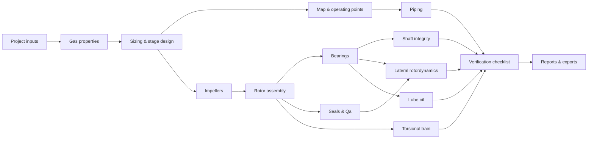

<p align="center">
  
</p>

<p align="center">
  <a href="https://github.com/Edgar-Mendonca/Compressor-Engineering-Suite/actions/workflows/ci.yml"></a>
  
  
  
</p>

**Compressor Engineering Suite** is an open-source, browser-based platform for the preliminary design, selection,
simulation and technical evaluation of industrial centrifugal compressors. Every module works on one shared
engineering model, so a change to the gas, an operating case, the shaft or a bearing propagates through
thermodynamics, aerodynamics, mechanics, rotordynamics and verification in a single run.

```
Process → Thermodynamics → Selection & aerodynamics → Impellers → Rotor & shaft → Bearings & seals
        → Lateral & torsional rotordynamics → Structural → Auxiliaries → Optimisation → Verification → Reports
```

> [!IMPORTANT]
> Results support preliminary engineering, design studies and comparisons. The suite does **not** certify
> compliance with API 617, API 614, API 692, ISO 15156 or any other standard. Acceptance criteria are configurable
> and must be checked against the edition that applies to your job. Detailed design and safety-critical
> conclusions require review by a qualified engineer.

<p align="center">
  
  
  
  
</p>

## Contents

- [Feature status](#feature-status)
- [Quick start](#quick-start)
- [Example result](#example-result)
- [How it works](#how-it-works)
- [Validation](#validation)
- [Project layout](#project-layout)
- [Documentation](#documentation)
- [Roadmap](#roadmap)
- [Contributing](#contributing)

## Feature status

✅ **Available now** — implemented and covered by tests · 🚧 **Yet to build** — known gaps in the current scope ·
💡 **Possible extensions** — ideas that fit the architecture and would add value

| Area | ✅ Available now | 🚧 Yet to build | 💡 Possible extensions |
|---|---|---|---|
| **Thermodynamics** | 19-component mixtures; Peng–Robinson (built in) or CoolProp; Z, ρ, h, s, cp/cv, sound speed, viscosity; dew/bubble points, phase envelope, water dew point; property charts | Thermal conductivity and other transport properties; direct GERG-2008; hydrate formation | Cantera transport properties; user-defined pseudo-components (C7+); REFPROP adapter |
| **Compression** | Real-gas polytropic path, isentropic and Schultz (ASME PTC 10); head, power, efficiency; efficiency back-calculated from test temperature; flow-unit conversions | Full ASME PTC 10 test evaluation (similarity, Mach/Re corrections) | ccp (Petrobras) adapter for test evaluation and curve conversion |
| **Selection & aerodynamics** | Type screening; stages, sections, intercooling, casings; speed and D2; φ/ψ, Ns/Ds; stage-by-stage design; stage-stacked map with surge/stonewall; variable/fixed-speed operating points; surge margin | Mean-line stage model (generic stage curves today); Mach-number effects on curves; side-streams; inlet guide vanes | TurboFlow or h2iCompressor mean-line engine; vendor stage-curve import; CFD-ready blade export |
| **Impellers & FEA** | Geometry estimate, slip and work coefficient, mass/inertia, axial thrust; rotating-disk FE; **axisymmetric impeller FEA** (hub, smeared blades, shroud; centrifugal + thermal; MCS and 115 % overspeed; eye/tip growth) validated against CalculiX; **interactive 3D FEA viewer** (stress/displacement contours, deformed shape, cut-away, mesh, blades) and meridional section plot | 3D blade and shroud stress (cyclic sector); impeller modal (blade/disk) analysis; shrink-fit contact | Parametric 3D impeller CAD with blades; Campbell/SAFE diagram for impellers; fatigue (Goodman) maps from FEA |
| **Rotor & shaft** | Parametric stepped shaft or user geometry; balance piston from thrust; collar, couplings, sleeves; mass/CG/inertia; bending/torque diagrams; Kt, Marin, DE-Goodman fatigue; transient-torque yield; sag and stiffness | Shrink-fit and keyway stresses under impellers; thermal bow | Interactive drag-and-drop shaft editor in the browser |
| **Bearings** | Plain and tilting-pad journals (Reynolds, pad equilibrium); K and C vs speed; film thickness; losses; oil flow; thrust-bearing sizing | Thermal (THD/TEHD) temperature model; finite-length bearings; frequency-reduced pad coefficients; thrust-bearing film model | Import of vendor bearing coefficient tables; magnetic bearings |
| **Seals** | Labyrinth and balance-piston leakage; modified-Wachel cross-coupling; dry-gas-seal leakage and supply; dew-point margin along the JT expansion path | Bulk-flow dynamic coefficients for labyrinth, hole-pattern and damper seals; seal-gas filter sizing | Full API 692 seal-gas panel sizing; oil-film seal model |
| **Lateral rotordynamics** | Timoshenko FE with gyroscopics; Campbell; whirl direction; mode shapes and 3D animation; undamped critical-speed map; unbalance response; AF; API 617-style separation and amplitude checks; Level I stability (Qa, Q0) | Level II stability with seal/impeller coefficients; pedestal and casing flexibility | Time-domain transient response; magnetic-bearing control loop |
| **Torsional** | Driver–coupling–gearbox–compressor train; modes; interference diagram; separation checks; forced response; synchronous-motor start-up transient; torsional fatigue | Air-gap torque from drive data; short-circuit transients; branched trains | openTorsion adapter; VFD interharmonic analysis |
| **Structural FEA** | Rotating-disk FE; CalculiX beam and axisymmetric input decks (exported and run when `ccx` is installed) | 3D impeller and casing FEA; structural optimisation | Code_Aster adapter; automatic meshing from the STEP model |
| **Lube oil & auxiliaries** | Oil flow from losses; pump, cooler (LMTD) and reservoir sizing; oil viscosity vs temperature | Pressure-drop network; accumulator and rundown tank; control-oil system | Full API 614 oil-console sizing with P&ID-style report |
| **Piping & flow** | NPS sizing on velocity and ρv²; Colebrook; compressible pressure drop; IEC 60534 recycle valve; ISO 5167 orifice; system curve | Pulsation and acoustics; dynamic anti-surge simulation | Anti-surge controller tuning; full process-loop simulation |
| **Material assessment** | 14-material database with temperature derating; **stage-by-stage sour/wet assessment** from the compressor design (pH₂S, pCO₂, water dew point, wet/dry, estimated condensed-water pH, illustrative SSC domain, de Waard–Milliams CO₂ corrosion vs allowance, settle-out case); **per-component records of documented limits and evidence** with verdicts (outside limits / evidence needed / within limits) feeding the checklist | Certified data sources; buffered-pH and scale-corrected corrosion models; impact-test rules | Sour-service qualification workflow with document attachments; corrosion-under-insulation and erosion checks |
| **Optimisation** | Parametric studies; normalised sensitivities; constrained COBYLA; configuration comparison; Pareto filter | Gradient-based multidisciplinary optimisation; multi-start/global search | OpenMDAO integration; design-of-experiments and surrogate models |
| **Verification** | Checklist of every module's checks (pass, fail, attention, qualified review) with references; versioned criteria object | Edition-specific criteria files reviewed by a qualified engineer; API 618, 614 and 692 detail | Sign-off workflow with reviewer comments |
| **Reports & data** | Datasheet; HTML and PDF reports; Excel workbook; JSON; STL and STEP; CalculiX decks; project revisions and calculation history | Word export; API datasheet form layout | Report templates per company; comparison report of several designs |
| **Platform** | Python + FastAPI backend; React + TypeScript browser app; SQLite storage; CLI; CI on every push | User accounts and access control; background job queue for long studies | Docker image and one-click deploy; multi-project dashboards; desktop installer |
| **Machine types** | Centrifugal compressors (API 617 scope) | Reciprocating (API 618) and screw compressors | Axial compressors; pumps and steam turbines on the same rotordynamics core |

## Quick start

You need **Python 3.10+**. Node.js is only needed to build or change the browser app.

```sh
git clone https://github.com/Edgar-Mendonca/Compressor-Engineering-Suite.git
cd Compressor-Engineering-Suite

# 1. Backend
cd backend
python -m venv .venv
source .venv/bin/activate            # Windows: .venv\Scripts\activate
pip install -e ".[test]"

# 2. Browser app (once; needs Node.js 18+)
cd ../frontend
npm ci
npm run build

# 3. Start
cd ../backend
compsuite serve                      # open http://127.0.0.1:8000
```

The first analysis runs automatically when the page opens (about 10–20 s). API documentation is at
`http://127.0.0.1:8000/docs`.

**Optional engines**, picked up automatically when installed:

| Install | Adds |
|---|---|
| `pip install CoolProp` | Reference-quality real-gas properties (select *CoolProp* on the gas page) |
| `pip install cadquery` | STEP export of the rotor |
| `pip install ross-rotordynamics` | Cross-check of the rotor model against Petrobras ROSS |
| CalculiX (`ccx` on the PATH) | Cross-check of the rotor model and running the exported FE decks |

**Command line** (no browser):

```sh
compsuite example > project.json          # the example project, edit as needed
compsuite run project.json --out results  # report.html, report.pdf, results.xlsx, results.json, rotor.stl
```

**Frontend development** with hot reload: run `compsuite serve`, then `npm run dev` in `frontend/` and open
`http://127.0.0.1:5173`.

## Example result

The built-in example is a 60 kg/s natural-gas compressor raising 30 bara to 90 bara on a variable-speed motor. One
full run gives:

| Result | Value |
|---|---|
| Configuration | Straight-through, 1 casing, 4 impellers |
| Speed / impeller diameter / tip speed | 15,062 rpm / 352 mm / 277 m/s |
| Polytropic efficiency / shaft power | 0.842 / 11.1 MW |
| Rotor | 427 kg, 1,465 mm bearing span, 175 mm shaft, tilting-pad bearings |
| Lateral | One critical speed (27,174 rpm) well above trip; Level I log decrement 0.71 with Qa = 3.9 MN/m |
| Checklist | 73 pass · 2 fail · 8 attention · 8 for qualified review |

The two failures are realistic design actions: the turndown case has only 6.6 % surge margin (an anti-surge recycle
is needed), and the first torsional mode sits 9.6 % below minimum speed against a 10 % requirement (coupling
selection).

## How it works



- **One data model.** `backend/compsuite/core/model.py` defines every input. The API publishes it as a JSON
  schema and the browser forms are generated from it, so a new input field shows up in the UI automatically.
- **Traceability.** Every result carries the method, engine, software version, input hash, assumptions,
  references and warnings. Reports print them; saved runs keep the project revision and input hash.
- **Adapters, not lock-in.** Built-in methods always work; external engines (CoolProp, ROSS, CalculiX, CadQuery)
  are used when installed and are compared against the built-in methods in the tests.

Technology: Python, NumPy, SciPy, pandas, pydantic, FastAPI, SQLite, matplotlib; React, TypeScript, Vite, Plotly,
Three.js.

## Validation

The test suite (`cd backend && pytest`) checks the calculations against analytical solutions and independent codes,
including:

| Check | Agreement |
|---|---|
| Simply supported shaft and Jeffcott rotor vs closed form | < 0.3 % |
| Rotor FE vs **CalculiX** beam model | < 1 % |
| Rotor FE vs **Petrobras ROSS** (anisotropic, cross-coupled bearings, gyroscopics) | frequency < 0.1 %, log dec < 0.002 |
| Plain journal bearing vs Ocvirk short-bearing theory | eccentricity < 0.001, attitude < 0.1° |
| Rotating disk vs closed-form bore stress | < 0.2 % |
| Peng–Robinson vs CoolProp (methane) | Z within 0.025, Δh within 1.5 % |
| Helium compression vs ideal-gas polytropic relation | < 0.2 K |

The full list is in [docs/VALIDATION.md](docs/VALIDATION.md).

## Project layout

```
backend/            Python engineering core (package "compsuite"), FastAPI server, tests
  compsuite/        thermo, compression, aero, impeller, mechanical, rotordynamics, bearings, seals,
                    torsional, structural, auxiliary, piping, materials, optimization, standards,
                    reporting, cad, api, core (model, workflow, storage, traceability)
frontend/           React + TypeScript browser app (Plotly charts, Three.js rotor viewer)
docs/               architecture, validation, library evaluation, roadmap, logo and screenshots
.github/workflows/  CI: backend tests and frontend build
```

## Documentation

- [Architecture](docs/ARCHITECTURE.md): data model, workflow, numerical methods, how to extend
- [Validation](docs/VALIDATION.md): reference cases and tolerances
- [Library evaluation](docs/LIBRARY_EVALUATION.md): the open-source projects considered, how each is used, licence notes
- [Status and roadmap](docs/ROADMAP.md): what is implemented against the original proposal, and what is next

## Roadmap

The 🚧 column of the [feature status](#feature-status) table is the backlog. Suggested order:

| Priority | Work item | Why first |
|---|---|---|
| 1 | Edition-specific acceptance criteria, reviewed by a qualified rotating-equipment engineer | Every pass/fail result depends on them |
| 2 | Mean-line aerodynamic model and vendor stage-curve import | Replaces the generic stage curves behind every map and operating point |
| 3 | Bulk-flow seal coefficients and Level II stability | Completes the API 617 rotordynamic assessment |
| 4 | Thermal (THD) bearing model or vendor bearing coefficients | Bearing temperatures are screening estimates today |
| 5 | Reciprocating (API 618) and screw compressors | Extends the suite beyond centrifugal machines |

Section-by-section detail against the original proposal is in [docs/ROADMAP.md](docs/ROADMAP.md).

## Contributing

Issues and pull requests are welcome. Please run the checks before opening a pull request:

```sh
cd backend && pytest
cd frontend && npm run build
```

New calculation methods should come with a validation test against an analytical solution, published data or an
independent code, and should record their assumptions in the result trace.

## Licence

No licence has been chosen yet, so the default copyright rules apply until one is added. See
[docs/LIBRARY_EVALUATION.md](docs/LIBRARY_EVALUATION.md) for the licences of the libraries the suite uses.
